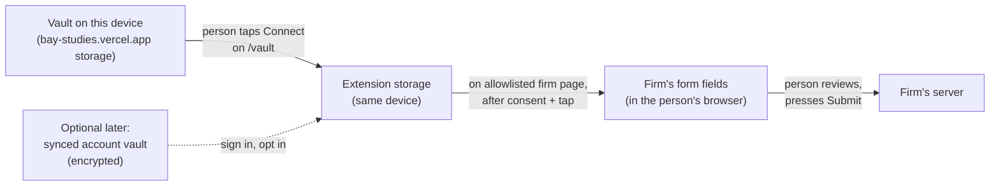

# Bay Studies — Real firm-site autofill (product sketch)

_Status: sketch for review, Oct 5, 2026. **Update Oct 7, 2026:** option B
("Copy next" phone helper) is built and live for the five pilot firms; see
[§11](#11-shipped-copy-next-phone-helper-option-b). The extension (A) is not
built yet. Builds on
[PROFILE_VAULT.md](./PROFILE_VAULT.md) and today's copy-only "Fill this
screener" helper._

The bridge still holds: **the studies feed is free for everyone. Optional
signup saves you time on firm applications and unlocks exclusive Bay Studies
projects.** Autofill is the "saves you time" half of that promise, made real.

---

## 1. Goal in one sentence

Instead of tapping a chip, switching tabs, and pasting one answer at a time,
the person opens a firm's screener and taps **Fill** once: their everyday
answers land in the right boxes, sensitive ones wait for a tap each, and they
read it over and press the firm's Submit themselves.

Today: ~10 copy-paste round trips per screener. Goal: one tap, a quick review,
and only the odd question typed by hand.

## 2. Non-goals

We will **not**:

- **Sell, share, or rent data.** Not the vault, not fill logs, not "which
  studies you looked at". Ever.
- **Auto-submit.** The helper never presses Submit, Next-on-the-last-page, or
  any "I agree" box. The person always does.
- **Store government ID numbers.** No SSN, driver's license, or passport
  numbers — not in the vault, not in the extension, not in logs. If a firm
  needs ID, the person shows it to the firm directly.
- **Invent answers.** No guessed DOB, no "qualifying" answers, no filling a
  question we don't have a saved answer for.
- **Create firm accounts or solve CAPTCHAs** for people.
- **Gate the feed.** Autofill is optional. The feed, study pages, and apply
  links stay free and public with no login.
- **Bulk-fill sensitive fields.** DOB, address, ethnicity, and health are
  always one field, one tap, every time.

## 3. Architecture options

### A) Browser extension

A small Chrome/Edge extension. It keeps a copy of the vault on the device,
recognises approved firm screener pages, and fills matching fields when the
person taps Fill in its little panel.

- **Good:** the only option that truly fills the firm's own page, in the
  person's own browser, on their own connection. Nothing goes through our
  servers. Clear, browser-enforced permission per site.
- **Not so good:** desktop only in practice (mobile Safari/Chrome extensions
  are awkward or need an App Store app). Needs a Chrome Web Store listing and
  review (one-time $5 developer fee — pays for itself easily). One more thing
  for people to install.

### B) In-app guided assist

Stays inside Bay Studies (side-by-side or overlay while the person — or Grok
Bot doing a panel fill for Evan — is on the firm site). Smarter than today's
chips: it knows that firm's form, shows answers **in the order the form asks
them**, one "Copy next" at a time, with notes like "Curion asks income on
page 2".

- **Good:** works on phones, no install, builds on code we already have.
  Matches how the Grok Bot panel-fill workflow already runs.
- **Not so good:** it still isn't real autofill. A web page can't type into
  another site's form (browsers block that, for good reason), so the person
  still pastes. The bot version only works where a bot is driving a browser,
  which doesn't scale to regular users.

### C) Server-side form automation

We run a browser in the cloud that fills and submits firm forms on the
person's behalf.

- **We discourage this.** It means people's personal details sit on our
  servers and get typed into firms' sites from our IP addresses. That looks
  like a bot to the firms (and often breaks their terms), invites CAPTCHAs and
  bans, and turns a convenience into a liability. It also tempts auto-submit.
  Not for Bay Studies.

### Recommendation

**Build A (desktop extension) as the real-autofill v1, and keep upgrading B as
the phone path.**

Why: A is the only option that delivers the actual goal without our servers
ever holding or typing anyone's data, which is the trust story the whole
bridge rests on. B is cheap to improve in parallel (firm-ordered "Copy next")
and covers mobile, where an extension can't go. C stays off the table.

## 4. Consent model

Same spirit as today's checklist, with two additions for real fills.

**Before the first fill session** (once per device, in the extension):

1. I opened this screener myself, on the firm's own site.
2. Fill my everyday details (name, email, phone, ZIP, work, and similar).
3. Ask me before each sensitive field (date of birth, address, ethnicity, health).
4. I'll check every answer and press the firm's Submit button myself.

Unticked = no fill. We re-show the checklist if the person clears data or
after 30 days, so it never fades into a forgotten blanket "allow".

**Per-domain allowlist.** The extension only works on firm sites Bay Studies
has reviewed (seeded from the `firmDomain` / `applyUrl` of approved studies,
e.g. `curionpanelist.com`, `participate.fieldwork.com`). The first time on a
firm, the person sees "Allow Bay Studies to fill on curionpanelist.com?" and
can say no, or revoke later from the extension. Shared hosts like Google
Forms are allowed **per form link**, never for the whole host.

**Everyday vs sensitive.**

- Everyday fields fill together on one tap of **Fill**.
- Sensitive fields are **never** part of that tap. Each one shows a small
  "Fill date of birth?" button next to the box. One tap = one field.
- If DOB is blank in the vault, the box stays blank. We never compute one
  from age or guess.

**Review and Submit.** Filled boxes get a soft highlight and an "Undo fill"
button. A short line in the panel reminds the person to read every answer.
The person presses the firm's Submit. We never do.

## 5. Data flow

- **Soft launch → v1:** the vault lives in the browser. The person taps
  **Connect extension** on `/vault`; the extension copies the vault into its
  own on-device storage. Edits on `/vault` re-sync the same way.
- **Later, optional:** an email magic-link account with an encrypted synced
  vault, so a phone-edited vault reaches a laptop. Opt-in; the extension
  still works without it.
- **What leaves the device:** only the answers the person fills, going to the
  firm they chose, when they press Submit. Nothing goes to Bay Studies.
- **What we might collect (opt-in, anonymous counts only):** "fill used on
  firm X", "N fields filled, M undone". No values, no names, no URLs with
  personal info.
- **Retention:** the extension keeps only the vault and the allowlist. No
  history of what was filled where. Uninstall or **Clear** wipes it. Synced
  vault (later) has one-tap export and delete.

## 6. Field matching

For each box on the page, the extension asks "which vault field is this?"
using, in rough order of trust:

1. **Per-firm field maps** we write by hand for pilot firms ("on Curion, the
   box named `zipcode` is ZIP"). Most accurate; small to maintain for ~5 firms.
2. **Autocomplete hints** the site already provides (`autocomplete="email"`,
   `tel`, `postal-code`, `given-name`).
3. **Label and nearby text** ("ZIP code", "Zip/Postal", "Mobile phone",
   "What is your employment status?").
4. **`name` / `id` / placeholder attributes** (`first_name`, `txtEmail`).
5. **Common screener patterns:** split first/last name, phone split into three
   boxes, income and education dropdowns, "Do you have children under 18?"

**Confidence and skip.** Each match gets a high / medium / low score. Only
high fills automatically; medium shows a "Fill?" suggestion; low and
unmatched boxes are left alone. Dropdowns and radio buttons only fill when the
vault answer clearly matches one of the firm's options (e.g. "$100k–$149k" vs
"$100,000–$149,999") — otherwise we leave it for the person.

**Hard rules.** Never fill a field we can't match. Never fill DOB, address,
ethnicity, or health without that field's own tap. Never touch password,
payment, SSN/license, signature, or consent/"I agree" boxes. Never invent a
DOB or any answer we don't have.

## 7. MVP scope (2–3 weeks)

**In:**

- Chrome/Edge desktop extension with a tiny panel: consent checklist, Fill,
  Undo, per-field sensitive buttons.
- **Connect extension** button on `/vault`.
- Fills: full name (and first/last split), email, phone, ZIP, age, gender,
  employment, job title, company/industry. DOB available as a per-field
  sensitive tap only, when present.
- Allowlist + hand-written field maps for **3–5 pilot firms**, plus the
  generic heuristics as fallback.
- Highlight of filled boxes and a plain "Check every answer, then press
  Submit" reminder.
- Phone path: today's helper gains firm-ordered "Copy next" for the same
  pilot firms (B-lite).

**Out (for MVP):**

- Accounts and synced vault.
- Mobile extension / native app.
- Multi-page screeners beyond what's on the current page (the person taps
  Fill again on each page).
- Embedded third-party survey tools inside iframes (Qualtrics, Alchemer) —
  note and handle later.
- Exclusive Bay Studies projects.
- Any anonymous usage counts beyond what we need to know it works.

## 8. Risks

- **Firm terms of service.** Some firms dislike automated entries. Mitigation:
  the person is on the page, in their own browser, and presses Submit; it's
  closer to the browser's own autofill than a bot. Still, tell pilot firms
  and stop on any firm that objects.
- **Phishing lookalikes.** A fake "curion-panel.com" could harvest vault data.
  Mitigation: exact-domain allowlist from approved studies only, HTTPS only,
  no wildcards on shared hosts, and no fill on unknown sites even if the
  person asks.
- **Wrong field fills.** Phone in the ZIP box, wrong income band. Mitigation:
  confidence threshold, skip unknowns, highlight + Undo, the review reminder,
  and a "this was wrong" button that feeds fixes into the firm map.
- **CPRA sensitive categories.** Ethnicity, health, precise address, and DOB
  are sensitive personal info under California law. Mitigation: never bulk,
  per-field tap every time, never sent to us, clear privacy page wording
  before launch, and a simple way to delete everything.
- **Store review and upkeep.** Chrome Web Store reviews permissions; firm
  forms change. Mitigation: request only the allowlisted sites, keep the
  pilot small, and fall back to copy chips when a map breaks.
- **Trust slip.** One bad fill or scary permission prompt can cost more than
  the time saved. Mitigation: plain-English permission text and start with
  friendly early users.

## 9. Success metrics

- **Time to complete a screener:** median minutes from opening the firm page
  to Submit, autofill vs copy chips. Target: about half.
- **Fields filled correctly:** of the fields we fill, % the person keeps (not
  undone or edited). Target: 95%+ on pilot firms.
- **Coverage:** % of a screener's fields we filled. Useful, but accuracy
  comes first.
- **Trust signals:** % who finish the consent checklist, allowlist "no"s,
  uninstalls in the first week, "this was wrong" reports, and plain feedback
  ("would you use this again?").
- **Bridge health:** feed visitors stay the same or grow (autofill must never
  shrink the free audience); share of visitors who choose to set up a vault.

## 10. Open questions for Evan

1. **Extension first, or bot-assist first?** Build the desktop extension now
   (real fills, desktop only), or spend the next two weeks on the in-app
   "Copy next" helper and bot-assisted fills (phone-friendly, still paste)?
2. **Do we require an account for sync?** Keep v1 device-only (no login, just
   "Connect extension"), or add an optional email magic-link account so a
   vault edited on a phone reaches the laptop?
3. **Which firms to pilot?** Suggested 3–5 with simple, stable forms:
   Curion, Fieldwork, CLC, Tasteocracy, Nichols Research. Swap any?
4. **Tell firms first?** Give pilot firms a heads-up that some applicants will
   use a fill helper, or launch quietly and respond if anyone asks?
5. **Anonymous usage counts — yes or no?** Opt-in counts like "fill used, 8
   fields, 1 undone" (no answers, no names) help us fix bad maps; or ship with
   zero collection and rely on feedback.

---

## 11. Shipped: "Copy next" phone helper (option B)

_Live Oct 7, 2026. Code: `src/lib/copyNext.ts`, `src/components/CopyNextHelper.tsx`._

**Decisions locked by Evan (Oct 5):** phone helper first, extension later;
device-only vault; zero fill telemetry; blank answers stay blank (skipped);
pilot firms Curion, Fieldwork, CLC, Tasteocracy, Nichols; quiet launch, no
firm outreach. Future in-house matching uses opt-in member profiles, never
fill data.

### What it does

On a study page for a pilot firm, the "How to sign up" box shows **Fill
helper: Copy next** instead of the copy chips. Non-pilot firms keep the chips.

1. The person ticks the same four-item consent checklist once per study.
2. The helper shows **Up next: First name** (with the value) and one big
   button. Each tap copies that answer to the clipboard and moves on, showing
   what's coming next ("Then: Email").
3. **Back**, **Skip**, and **Jump to…** (the full list with ✓ copied / – skipped)
   are always there. **Start over** clears this study's progress.
4. Sensitive fields (date of birth, street address, ethnicity, health) show
   masked. The first tap shows the value, a second tap copies it. Same
   "Show & copy" idea as the chips.
5. Done screen: "Check every answer, then press their Submit yourself."

### Privacy rules in code

- Values come from this browser's vault + profile and go only to the
  clipboard. No network calls, no analytics events, no logging.
- Progress lives in `localStorage` under `bay-studies-copy-next-v1:<studyId>`
  and stores **field keys and position only** (`nextKey`, `copied`, `skipped`,
  `consented`), never answers. It expires after 7 days. That's what keeps the
  person's place when iOS Safari switches tabs or reloads the page; the helper
  also re-reads vault + progress on `visibilitychange`, `focus` and `pageshow`.
- Blank answers are dropped from the steps. Nothing is computed or guessed
  (no DOB from age). The only derived values are **First name / Last name**,
  split from the saved Full name at the last space, with "Full name (one box)"
  offered right after for forms that use one box. A one-word name is offered
  only as Full name.
- Government ID numbers are never offered: the vault has no such fields, and
  the step builder also rejects any key or label that looks like SSN, license,
  passport or tax ID.
- Clipboard: `navigator.clipboard.writeText` inside the tap, with a hidden
  textarea + `execCommand("copy")` fallback for older iOS. If both fail, the
  value is shown selectable so the person can press-and-hold to copy.

### Per-firm field order

**None of these orders has been checked against the firms' live forms yet.**
They're a sensible default: contact first (nearly every panel form starts
there), then demographics, then the firm's likely focus. Fix any of them in
`PILOT_FIRMS` after the first real run on that firm. After the firm order,
the helper adds anything else already in the vault, in vault section order.

| Firm | Order after contact (First, Last, Full, Email, Phone, ZIP) | Why |
|---|---|---|
| Curion | DOB, Age, Gender, Ethnicity, Kids, Marital, Housing, Income, Education, Employment, Job title, Company, Pets | Food/product tests: household first, work later |
| Tasteocracy | DOB, Age, Gender, Ethnicity, Kids, Pets, Marital, Income, Education, Employment | Taste tests: who lives at home matters early |
| CLC | DOB, Age, Gender, Ethnicity, Kids, Marital, Education, Income, Employment, Job title, Company, Phone/OS | Mix of taste and tech/UX studies |
| Fieldwork | DOB, Age, Gender, Ethnicity, Employment, Job title, Company, Education, Income, Marital, Kids | Focus groups screen on work early |
| Nichols Research | DOB, Age, Gender, Ethnicity, Employment, Job title, Company, Education, Income, Marital, Kids, Housing | Same as Fieldwork, plus housing |
| Default (non-pilot) | n/a: copy chips, no ordered helper | Pilot only for now |

Firm matching uses the study's firm name and domains (`curion`, `tasteocracy`,
`fieldwork`, `nichols`, `theclc` / `clc-research` / `consumerlearningcenter`).
